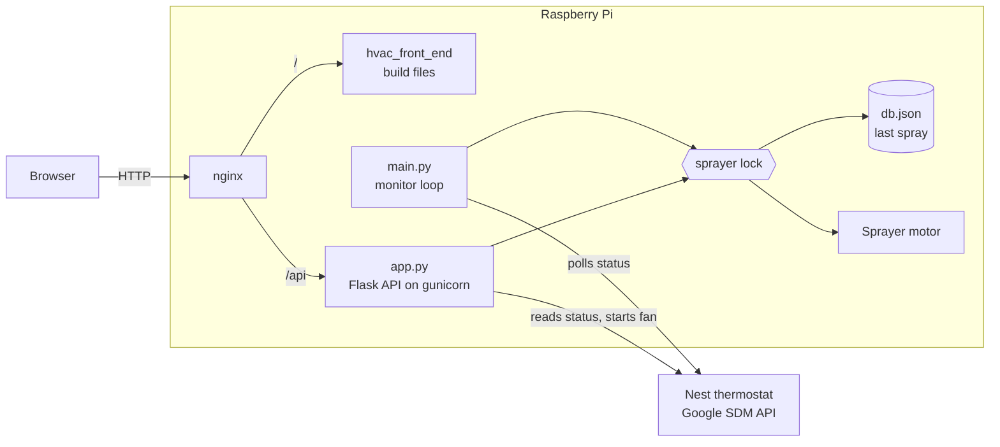

# Automatic HVAC Air Freshener

A Raspberry Pi that freshens a whole house using the air conditioning. It polls a Nest thermostat through Google's Smart Device Management API, and whenever the system is heating or cooling, it drives a motor that presses an air freshener can aimed at the air filter in the return duct. The running HVAC system then carries the scent through the house.

This repository is the backend. It exposes an HTTP API for triggering a spray and checking on the system, and [hvac_front_end](https://github.com/kcmodev/hvac_front_end) is the React web interface that uses it. On the Pi, nginx serves both from one address.

## How it works

Two independent processes share the same hardware and spray history:



**The monitor** (`main.py`) decides when to spray automatically:

| Situation | Action | Next check |
| --- | --- | --- |
| Outside 08:00–22:00 | Nothing | 30 minutes |
| HVAC heating or cooling | Spray twice | 30 minutes |
| HVAC idle | Nothing | 5 minutes |
| Thermostat unreachable | Log a warning | 5 minutes |

**The API** (`app.py`) handles manual sprays. Since no air may be moving when one is requested, it first runs the HVAC fan for 15 minutes, waits 10 seconds for airflow, then sprays. If the fan can't be started, it doesn't spray.

### Design notes

- **Failures never trigger a spray.** Any thermostat error raises `ThermostatError` rather than falling back to a previous reading, so a stale `COOLING` can't cause a spray.
- **One sprayer, two processes.** A non-blocking file lock stops the API and monitor from driving the motor at the same time. The second caller gets `SprayerBusyError`, which the API returns as `409 Conflict`. GPIO pins are held only during a spray so the other process can open them next.
- **One address for the browser.** nginx serves the web interface and passes `/api` requests to gunicorn, which accepts connections only from the Pi itself. The browser never makes a cross-origin request, so the API needs no CORS settings and the frontend build has no API address baked in.
- **Hardware is simulated off the Pi.** gpiozero's mock pin factory lets the real motor code run in tests, including checks of the speed sequence.

## Hardware

- Raspberry Pi with network access
- DC motor and motor driver, mechanically linked to press the can
- Google Nest thermostat

| Driver input | GPIO (BCM) |
| --- | --- |
| Forward | 23 |
| Backward | 24 |
| Enable (PWM) | 12 |

Speeds and timings are constants at the top of [`pi_logic/motor_logic.py`](pi_logic/motor_logic.py), and will need tuning for a different mechanism.

## Setup

Requires Python 3.9 or newer.

### 1. Get Nest API credentials

Follow Google's [Device Access getting started guide](https://developers.google.com/nest/device-access/get-started) to register for Device Access, create an OAuth client and authorize your account. You'll need the client ID, client secret, refresh token, Device Access project ID and thermostat device ID.

### 2. Install

```bash
git clone https://github.com/kcmodev/pi_hvac_controller.git
cd pi_hvac_controller

# On Raspberry Pi OS, --system-site-packages exposes the preinstalled GPIO libraries
python3 -m venv --system-site-packages venv
source venv/bin/activate
pip install -r requirements.txt

cp .env.example .env   # then fill in your credentials
```

### 3. Try it

To check that everything works, start each process in its own terminal:

```bash
python main.py   # monitor loop
python app.py    # API, at http://127.0.0.1:8000
```

`app.py` uses Flask's development server and is reachable only from the Pi itself. To run the system permanently, with the web interface, follow the next section.

## Deploying on the Pi

[`deploy/`](deploy) holds the configuration for running the system as services. nginx serves the web interface at `http://<pi-address>/` and passes `/api` requests to gunicorn, while systemd starts the API and monitor at boot and restarts them if they crash.

These steps continue from [Setup](#setup), in the cloned folder on the Pi.

1. **Install nginx:**

   ```bash
   sudo apt install nginx
   ```

2. **Start the API and monitor.** The service files assume the user `pi` and the folder `/home/pi/pi_hvac_controller`, so edit `User` and the paths first if yours differ.

   ```bash
   sudo cp deploy/systemd/hvac-*.service /etc/systemd/system/
   sudo systemctl daemon-reload
   sudo systemctl enable --now hvac-api hvac-monitor
   ```

3. **Set up the web server.** The site replaces nginx's default page on port 80.

   ```bash
   sudo cp deploy/nginx/hvac.conf /etc/nginx/sites-available/hvac
   sudo ln -s /etc/nginx/sites-available/hvac /etc/nginx/sites-enabled/hvac
   sudo rm /etc/nginx/sites-enabled/default
   sudo nginx -t && sudo systemctl reload nginx
   ```

4. **Add the web interface.** Create its folder, owned by your user so builds can be copied in without `sudo`, then follow the deploy steps in [hvac_front_end](https://github.com/kcmodev/hvac_front_end#deploying).

   ```bash
   sudo mkdir -p /var/www/hvac
   sudo chown "$USER" /var/www/hvac
   ```

To check on the system:

```bash
systemctl status hvac-api hvac-monitor
journalctl -u hvac-monitor -f   # follow the monitor's log
curl http://localhost/api/status
```

To update, run `git pull` and `venv/bin/pip install -r requirements.txt`, then `sudo systemctl restart hvac-api hvac-monitor`.

## Configuration

Settings are read from the environment or a `.env` file.

| Variable | Required | Default | Purpose |
| --- | --- | --- | --- |
| `NEST_CLIENT_ID` | Yes | | OAuth client ID |
| `NEST_CLIENT_SECRET` | Yes | | OAuth client secret |
| `NEST_REFRESH_TOKEN` | Yes | | OAuth refresh token |
| `NEST_PROJECT_ID` | Yes | | Device Access project ID |
| `NEST_DEVICE_ID` | Yes | | Thermostat device ID |
| `HOST` | No | `127.0.0.1` | Bind address for `python app.py` |
| `PORT` | No | `8000` | Port for `python app.py` |
| `SPRAY_DB_PATH` | No | `db.json` in the project root | Spray history file |

gunicorn ignores `HOST` and `PORT`. Its settings are in [`gunicorn.conf.py`](gunicorn.conf.py).

## API

| Method | Path | Description | Responses |
| --- | --- | --- | --- |
| `POST` | `/api/spray` | Run the fan and spray. Takes about 15 seconds | `200` `{"date", "time"}`, `409` busy, `502` thermostat error, `503` not configured |
| `GET` | `/api/timestamp` | Most recent spray | `200` `{"date", "time"}`, `404` none yet |
| `GET` | `/api/status` | Current HVAC state | `200` `{"status"}`, `502` thermostat error, `503` not configured |

## Development

No Raspberry Pi or Nest account is needed to run the tests:

```bash
pip install -r requirements-dev.txt

pytest
ruff check .
ruff format --check .
```

To run the API away from a Pi, uncomment the `GPIOZERO_*` lines in `.env`. Without credentials, the thermostat routes respond with `503`. The frontend's development server sends its `/api` requests to `http://127.0.0.1:8000` by default, so the two work together locally.

```
├── app.py                  API routes
├── main.py                 Monitor loop and scheduling rules
├── gunicorn.conf.py        Production server settings
├── deploy/
│   ├── nginx/              Web server site
│   └── systemd/            Services for the API and monitor
├── pi_logic/
│   ├── config.py           Environment-based settings
│   ├── motor_logic.py      Motor control and the sprayer lock
│   ├── spray_log.py        Last spray persistence (TinyDB)
│   └── thermostat_logic.py Nest API client
└── tests/
```

## Security

The API has no authentication. gunicorn accepts connections only from the Pi itself, but nginx passes along requests from anywhere on the network, so anyone who can reach the Pi can trigger the sprayer and read the HVAC status. Keep it on a trusted home network and never expose it to the internet. `.env` holds a long-lived refresh token and is ignored by git; never commit it.

## License

[MIT](LICENSE)
